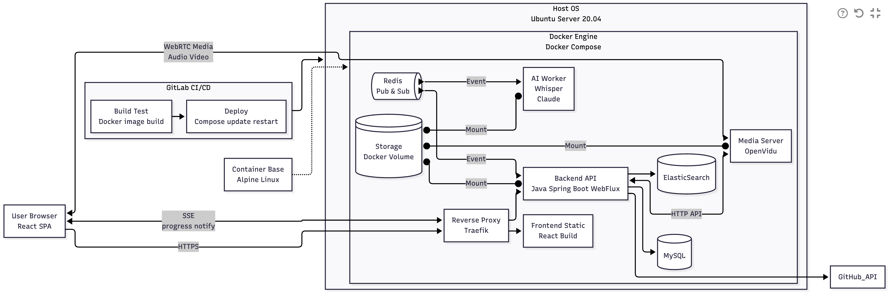
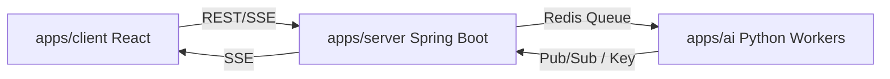
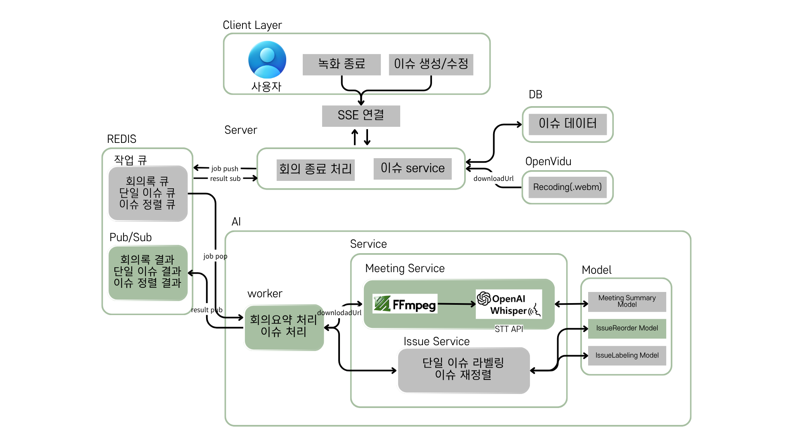

<!-- logo -->

### Didit - AI 기반 팀 협업 플랫폼

 

## 📝 전체 서비스 설명

**Didit**은 실시간 화상 회의부터 AI 회의록 자동 생성까지, 팀 협업에 필요한 기능을 한곳에 모은 **AI 기반 팀 협업 플랫폼**입니다.

- **GitHub OAuth** 로그인 및 프로젝트·채널 관리
- **OpenVidu** 기반 실시간 화상 회의 (화면 공유, 채팅)
- **GitHub 이슈 연동** + AI 우선순위 분석·재정렬
- **AI 회의록 자동 생성** (Whisper STT → Gemini 요약)

 

## 🏗️ 프로젝트 아키텍처

 

## 🤖 AI 기능 상세

AI 레이어는 **Redis 큐 기반 비동기 워커** 패턴으로 동작합니다. Spring Boot가 작업을 큐에 push하면 Python 워커가 추론 후 Pub/Sub 또는 Redis Key로 결과를 반환하고, 서버는 SSE로 클라이언트에 실시간 알림을 전달합니다.

- **비동기 처리**: Redis Queue 폴링 워커 (`issue_priority_worker`, `meeting_summary_worker`)
- **이슈 우선순위**: Llama-3 4bit Few-shot 라벨링 + HF 한국어 분류 모델 재정렬
- **회의 요약**: ffmpeg 오디오 변환 → Whisper STT → Gemini 2.5 Flash JSON 요약

### AI 아키텍처

 

### 서비스 소개

https://github.com/Spinxxx-Soo/DIDIT/raw/docs/readme/assets/didit-demo.mp4

Didit 주요 기능 데모 — 로그인 · 라운지 · AI 이슈 분석 · 화상 회의 · 회의록 요약

 

## ⚙ 기술 스택

### Frontend

### Backend

### AI

### Infra

### Tools

 

## 👤 맡은 역할

저는 이 프로젝트에서 **AI 파트**를 맡아 아래를 구현했습니다.

- Redis 큐 기반 **비동기 AI 워커** 아키텍처 설계·구현
- **Llama-3 4bit** Few-shot 이슈 우선순위 라벨링 (VRAM 6GB 최적화)
- **HF 한국어 분류 모델** + 규칙 기반 하이브리드 이슈 재정렬
- **Whisper STT → Gemini** 회의 요약 파이프라인 (ffmpeg 오디오 전처리 포함)
- Spring Boot ↔ AI 간 Redis Queue / Pub/Sub 연동 스키마 정의

 

## 🤔 기술적 이슈와 해결 과정

- **VRAM 6GB 제약**
    - Llama-3 8B 로드 시 OOM 발생 → 4bit 양자화(`BitsAndBytesConfig`)와 `device_map` / `max_memory` 튜닝으로 6GB GPU에서 추론 가능하도록 최적화
- **이슈 재정렬 정확도**
    - 단순 ML 점수만으로는 도메인 키워드(버그, 개선 등) 반영이 부족 → 모델 점수 + 키워드 부스트/패널티 규칙 하이브리드 적용
- **비동기 AI 처리와 실시간 UI**
    - LLM 추론 지연으로 동기 API 응답 불가 → Redis Queue 폴링 워커 + Pub/Sub으로 분석 완료 시 SSE 브로드캐스트 연동

 